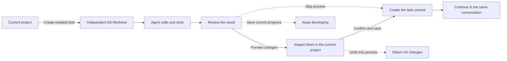
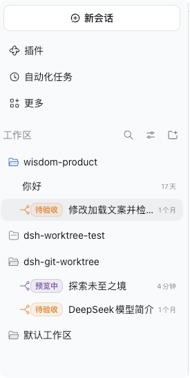

# dsh-git-worktree

> Development installation policy: DSH peers use a minimum of `>=0.2.1-rc.2`, with no speculative upper bound; requirements change when breaking changes are confirmed. Build dependencies and embedded Browser sources remain exact. Unknown Hosts retain the official Workspace rather than reusing an unverified derivative. Installation permission is not acceptance evidence. Standard SemVer includes later RCs of the same `0.2.1` core; prereleases of other future cores are not matched by default. Exact peer constraints below describe historical published releases.

[](https://www.npmjs.com/package/dsh-git-worktree)
[](https://www.npmjs.com/package/dsh-git-worktree)
[](https://github.com/wloops/dsh-git-worktree/actions/workflows/ci.yml)
[](LICENSE)

**Let agents complete tasks in independent Git Worktrees, then review the changes before deciding whether to save them.**

`dsh-git-worktree` is a Git Worktree plugin for [DeepSeek Harness](https://github.com/deepseek-ai/DeepSeek-Harness). It creates a separate Worktree (working directory) for each isolated task, where the agent edits and tests code. The plugin writes task changes back to the current project only when you start a preview or confirm saving. When the task is complete, you can preview the result and then save it, send it back for changes, or discard it.

This Git Worktree workflow originated in [Domi](https://github.com/restflux/domi), an open-source desktop coding workbench powered by the Pi Agent Runtime. This plugin is independently adapted for DeepSeek Harness and can be installed and used on its own.

[中文](README.md) · [Full usage guide](docs/USAGE.en.md) · [Architecture](docs/WORKTREE-CONSOLE-ARCHITECTURE.md)

## Why use it?

When an agent edits the current project directly, its changes can mix with your unfinished work. Running multiple tasks at once can also make them interfere with one another. With this plugin:

- every task is edited and tested in its own Git Worktree (an independent working directory);
- multiple isolated tasks can develop in parallel in separate working directories; only one task per project can enter the review write-back flow at a time;
- when the agent finishes, you can temporarily show the changes in the current project and inspect them;
- changes are saved only after confirmation, and conflicts never overwrite your work automatically.

## Highlights

- **Git Worktree isolation**: every task gets its own working directory and its own agent conversation.
- **Run multiple Worktrees**: develop several tasks in parallel; to avoid mixing changes, review one task at a time per project.
- **Preview before committing**: inspect the real result in the current project without immediately creating a Git commit.
- **Send it back safely**: undo the current preview and ask the agent for more changes without disturbing unrelated local work.
- **Save only this task**: confirmation commits only the current task instead of pulling unrelated changes into it.
- **Preserve progress on long tasks**: save the current stage and keep developing; the stages still become one final delivery.
- **Protect the working state**: branch changes, conflicts, and interrupted operations stop safely and leave the state available for recovery.
- **See related tasks together**: current and historical Worktrees are grouped under their Host-provided project navigation owner; ambiguous tasks conservatively remain where they are.
- **Inspect review details in one place**: open a read-only view from the review bar for changed files, validation records, and version details without searching tool messages.
- **Start safely from an empty repository**: after explicit confirmation, an unborn repository can receive an empty initial commit that excludes user files before the isolated Worktree is created.
- **Carry project Skills**: the first Worktree and each next iteration receive one snapshot of `.dsh/skills`, `.agents/skills`, and `.claude/skills`, while auxiliary files stay separate from Git delivery.
- **Continue in the same conversation**: after delivery, begin another task without opening a new conversation.

> The current version manages Git Worktrees within one project. It does not yet provide a global cross-project manager.

## Workflow



### Which action should I choose?

| Goal | Action |
| --- | --- |
| Inspect the result in the current project | **Preview changes** |
| The preview looks correct | **Confirm and save** |
| Preserve progress during a long task | **Save checkpoint and continue** |
| Ask the agent for more edits | **Continue editing** or **Undo this preview** |
| Save without inspecting it first | **Skip preview and save** |

See the [full usage guide](docs/USAGE.en.md) for detailed actions, recovery scenarios, and commands.

## Quick start

### Requirements

- Node.js `^22.19.0 || >=24.0.0`
- DeepSeek Harness Web Client
- A Git Workspace
- A plugin version matching your Harness version, as listed below

### Choose a version

| DeepSeek Harness | Plugin version |
| --- | --- |
| `0.2.1-rc.2` (build baseline) | `0.12.0` (current version) |
| `0.2.0-rc.2` | `0.10.0` |
| `0.1.x` | See the historical `0.9.x` compatibility records; not every `0.1.x` version has been verified |

Match the plugin version to your Harness version rather than installing the latest plugin on an older Harness.

**0.12.2 release candidate:** adds an exact DSH `0.2.2-rc.1` sidebar adaptation, preserves existing aggregation, and contributes native decorations on unknown Hosts through public slots. Includes development-startup fixes and localized plugin descriptions with a dedicated icon. Full native aggregation and complete new-Host acceptance remain unverified; not yet published to npm. See [release notes](docs/release-notes-v0.12.2.md) and [compatibility notes](docs/COMPATIBILITY.md).

`0.12.0` requires DSH `>=0.2.1-rc.2`, while the build baseline remains `0.2.1-rc.2`. Installation on `0.2.1-rc.5` is permitted but has not completed real-environment acceptance; unknown Hosts retain the official Workspace sidebar. Installation permission does not establish runtime compatibility.

The DSH `0.2.1-rc.2` adaptation included in `0.11.0` passed pre-release source compatibility checks. Browser, real AI conversation, desktop and Windows end-to-end acceptance for this combination remain incomplete. This historical validation is not acceptance evidence for `0.12.0` or newer Hosts. See the [compatibility notes](docs/COMPATIBILITY.md#english), [validation report](docs/compatibility/0.2.1-rc.2.md) and [0.12.0 release notes](CHANGELOG.md#0120---2026-11-02) for the scope.

### Install

For DSH `0.2.1-rc.2`, install through the `dsh` Web Profile:

```bash
dsh plugin --profile web add dsh-git-worktree@0.12.0
```

For other Harness versions, choose the matching plugin version from the table above first.

Open a Git Workspace and enable **Worktree** when creating a Session. An existing Local Session can also let the agent call `worktree_create` to create a separate isolated Session.

For the first run, complete one full create → Preview changes → Confirm and save → clean up the Worktree cycle.

### Upgrades and troubleshooting

- Back up your data and check version compatibility before upgrading Harness. See the [compatibility notes](docs/COMPATIBILITY.md#english) for legacy data migration requirements.
- If the UI shows **Failed to load plugins**, first check that the plugin and Harness versions match, then follow the troubleshooting guide.
- Harness's supply-chain guard (`minimumReleaseAge`) may skip a freshly published release and fall back to an older one. Specify the matching exact version explicitly or retry after the guard window passes.

For Git-source installation, pnpm build approval and other troubleshooting steps, see [Installation and troubleshooting](docs/USAGE.en.md#installation-and-troubleshooting).

## Screenshots

### Project grouping and task status



### Prepare the review


See the [full usage guide](docs/USAGE.en.md#complete-delivery-example) for the complete flow.

## Safety boundary

Before writing task changes back to the current project, the plugin checks again that the task version, project location, and file state still match the review. If you switched branches, changes conflict, or a previous operation was interrupted, it stops and preserves the working state instead of guessing and overwriting files.

Worktree separation is designed to prevent tasks from accidentally changing one another's files. It is not a system sandbox for running untrusted code.

For the detailed state checks and recovery rules, see:

- [Worktree Console architecture](docs/WORKTREE-CONSOLE-ARCHITECTURE.md)
- [Session Target porting notes](docs/PORTING.md)

## Current limitations

- A task is grouped under its original project only when that relationship is clear. Uncertain tasks remain in their original location so they are never hidden.
- Isolated tasks can be renamed and archived, but a new task cannot yet be forked directly from the task conversation.
- Child agents share the parent task's working directory; a separate Worktree is not created for every child agent.
- Saved stage records cannot yet be edited, deleted, reordered, or rolled back to an arbitrary stage.
- The broader cross-project management, direct repair of the current project, dependency reuse, and collaboration handoff features in [Domi](https://github.com/restflux/domi) are outside this plugin's current scope.

## Local development

```bash
pnpm install
pnpm run typecheck
pnpm test
pnpm run build
pnpm run check:publish
```

Run the local end-to-end environment:

```bash
pnpm run dev:dsh
```

See the [full usage guide](docs/USAGE.en.md#local-development) for more development commands and the [release checklist](docs/RELEASE.md) before publishing.

## Documentation

- [Full usage guide](docs/USAGE.en.md)
- [Worktree Console architecture](docs/WORKTREE-CONSOLE-ARCHITECTURE.md)
- [Session Target porting notes](docs/PORTING.md)
- [UI development notes](docs/UI-DEVELOPMENT.md)
- [Release checklist](docs/RELEASE.md)
- [Changelog](CHANGELOG.md)

## License

[MIT](LICENSE)

## Language

The plugin follows DSH’s language selection without a separate switch. Explicitly select English in DSH to use English in the UI, tools, and `/worktree` messages. If automatic browser detection has not produced a saved DSH preference, tools and commands fall back to Chinese. See [language transport and translation contributions](docs/i18n.md).
