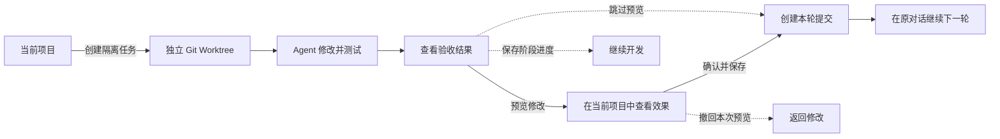
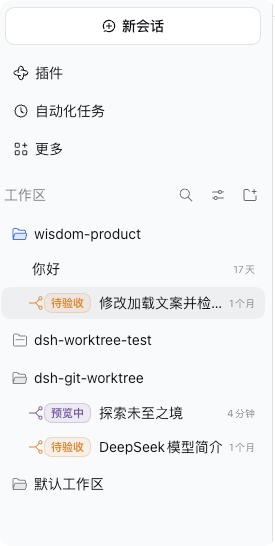
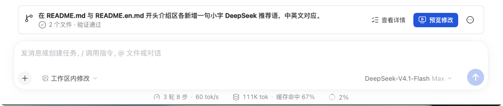

# dsh-git-worktree

> 当前开发版安装策略：DSH peer 使用最低版本 `>=0.2.1-rc.2`，不设置预防性上限；仅在确认破坏性变化后调整要求。开发依赖和内嵌侧栏来源继续精确锁定。未知宿主不复用旧侧栏，而保留官方 Workspace，其他插件功能按实际 API 运行。允许安装并不等于已验收；SemVer 默认仅自动包含同一 `0.2.1` 核心版本的后续 RC，未来其他核心版本的预发布不属于默认匹配。下方精确 peer 描述均为已发布历史版本的记录。

[](https://www.npmjs.com/package/dsh-git-worktree)
[](https://www.npmjs.com/package/dsh-git-worktree)
[](https://github.com/wloops/dsh-git-worktree/actions/workflows/ci.yml)
[](LICENSE)

**让 Agent 在独立 Git Worktree 中完成任务，你看过修改后再决定是否保存。**

`dsh-git-worktree` 是 [DeepSeek Harness](https://github.com/deepseek-ai/DeepSeek-Harness) 的 Git Worktree 插件。它为隔离任务创建独立的 Worktree（工作目录），Agent 的代码修改和测试在其中进行；只有你发起预览或确认保存时，插件才会把任务改动写回当前项目。任务完成后，你可以先预览结果，再选择保存、退回修改或放弃。

这套 Git Worktree 工作方式最初来自基于 Pi Agent Runtime 的开源桌面 coding 工作台 [Domi](https://github.com/restflux/domi)，本插件是针对 DeepSeek Harness 独立适配的版本，可以单独安装和使用。

[English](README.en.md) · [完整使用指南](docs/USAGE.md) · [架构说明](docs/WORKTREE-CONSOLE-ARCHITECTURE.md)

## 为什么使用它？

让 Agent 直接修改当前项目时，它的改动可能与你尚未提交的内容混在一起；同时运行多个任务时，也更容易互相影响。使用本插件后：

- 每个任务都在自己的 Git Worktree（独立工作目录）中修改和测试；
- 多个隔离任务可以同时开发，各自使用独立工作目录；同一项目一次只允许一个任务进入验收写回流程；
- Agent 完成后，你可以先把修改临时显示在当前项目中查看；
- 只有确认后才会保存本轮修改，遇到冲突时不会自动覆盖你的内容。

## 核心能力

- **Git Worktree 隔离**：每个任务都有独立的工作目录和 Agent 对话。
- **多个 Worktree 并行**：可以同时开发多个任务；为了避免混入修改，同一项目每次只验收一个任务。
- **提交前预览**：先在当前项目中查看真实效果，不会立即创建 Git 提交。
- **不满意可以退回**：撤回本次预览，继续让 Agent 修改，不影响其他本地改动。
- **只保存本轮任务**：确认后只提交这个任务的修改，不把无关内容一起带入。
- **长任务可分阶段**：先保存当前阶段的进度，再继续开发；最终仍合并为一次交付。
- **出错时保护现场**：检测到分支变化、内容冲突或中断时停止操作，保留现场供你处理。
- **集中查看任务**：同一项目的当前及历史 Worktree 会按 Host 导航归属聚合到侧边栏，归属不明确时保守保留原位置。
- **验收详情集中查看**：从验收条打开只读详情，查看文件列表、验证记录与版本信息，不必翻找聊天工具记录。
- **空仓库安全起步**：无提交仓库可在明确确认后创建不包含用户文件的空首次提交，再建立隔离 Worktree。
- **携带项目 Skills**：首次及下一轮 Worktree 创建时一次性携带 `.dsh/skills`、`.agents/skills` 和 `.claude/skills`，辅助文件与 Git 交付隔离。
- **原对话继续下一轮**：任务交付后，无需新开对话即可继续下一项修改。

> 当前版本管理单个项目中的 Git Worktree，暂不提供跨项目的全局管理界面。

## 工作流



### 怎么选？

| 目标 | 操作 |
| --- | --- |
| 先在当前项目中查看效果 | **预览修改** |
| 预览结果没有问题 | **确认并保存** |
| 任务很长，先固定当前进度 | **保存阶段并继续** |
| 还要让 Agent 改代码 | **继续修改**或**撤回本次预览** |
| 不需要先查看效果 | **跳过预览并保存** |

详细的操作、恢复场景和命令见[完整使用指南](docs/USAGE.md)。

## 快速开始

### 环境要求

- Node.js `^22.19.0 || >=24.0.0`
- DeepSeek Harness Web Client
- Git Workspace
- 与 Harness 版本匹配的插件版本，见下表

### 版本选择

| DeepSeek Harness | 插件版本 |
| --- | --- |
| `0.2.1-rc.2` | `0.11.0` |
| `0.2.0-rc.2` | `0.10.0` |
| `0.1.x` | 请参考 `0.9.x` 的历史兼容记录，不代表所有 `0.1.x` 版本均已验证 |

插件版本与 Harness 版本需要匹配，不建议在旧版 Harness 上直接安装最新版插件。

`0.11.0` 对应的 DSH `0.2.1-rc.2` 适配已通过发布前源码兼容检查，但尚未完成该组合的浏览器、真实 AI 对话、桌面端和 Windows 全流程验收。详细验证范围见[兼容性说明](docs/COMPATIBILITY.md#中文)与[验证报告](docs/compatibility/0.2.1-rc.2.md)；旧组合的验证记录仍保留，不自动转为新组合的验收证据。

### 安装

以下命令适用于 DSH `0.2.1-rc.2`，通过 `dsh` 的 Web Profile 安装：

```bash
dsh plugin --profile web add dsh-git-worktree@0.11.0
```

如果使用其他 Harness 版本，请先按上表选择匹配的插件版本。

安装后打开 Git Workspace，在新建 Session 时启用 **Worktree**；已有 Local Session 也可以让 Agent 调用 `worktree_create` 创建独立的隔离 Session。

第一次使用建议先完成一次“创建 → 预览修改 → 确认并保存 → 清理 Worktree”的完整流程。

### 升级与排错

- 升级 Harness 前，请先备份数据并检查版本兼容性；旧版数据迁移要求见[升级与回退](docs/COMPATIBILITY.md#升级与回退)。
- 出现 **Failed to load plugins** 时，先确认插件与 Harness 版本匹配，再按使用指南排查。
- 刚发布的版本可能被 Harness 的供应链防护（`minimumReleaseAge`）暂时跳过而回退旧版；可显式指定匹配的精确版本，或待防护窗口过后重试。

Git 源安装方式、pnpm build approval 及其他排错步骤见[安装与排错](docs/USAGE.md#安装与排错)。

## 界面预览

### 项目聚合与任务状态



### 准备验收



完整操作步骤见[完整使用指南](docs/USAGE.md#完整交付示例)。

## 安全边界

每次把任务修改写回当前项目之前，插件都会重新确认任务版本、项目位置和文件状态仍与验收时一致。如果你切换了分支、修改发生冲突，或上一次操作意外中断，插件会停止写入并保留现场，而不是猜测后继续覆盖。

Worktree 隔离主要用于避免任务之间误改文件，不是用来运行不受信任代码的系统沙箱。

更详细的状态检查与恢复规则见：

- [Worktree Console 架构](docs/WORKTREE-CONSOLE-ARCHITECTURE.md)
- [Session Target 迁移说明](docs/PORTING.md)

## 当前限制

- 只有归属关系明确的任务才会聚合到原项目；无法确认时仍保留原位置，避免任务被隐藏。
- 隔离任务可以重命名和归档，暂不支持从任务对话直接复制出新任务（Fork）。
- 子 Agent 与父任务使用同一个工作目录，不会再为每个子 Agent 创建新的 Worktree。
- 已保存的阶段记录暂不支持编辑、删除、调整顺序或回退到任意阶段。
- [Domi](https://github.com/restflux/domi) 中更完整的跨项目管理、直接修复当前项目、依赖复用和协作交接能力不在本插件当前范围内。

## 本地开发

```bash
pnpm install
pnpm run typecheck
pnpm test
pnpm run build
pnpm run check:publish
```

端到端启动：

```bash
pnpm run dev:dsh
```

更多开发命令见[完整使用指南](docs/USAGE.md#本地开发)，发布前检查见[发布清单](docs/RELEASE.md)。

## 文档

- [完整使用指南](docs/USAGE.md)
- [Worktree Console 架构](docs/WORKTREE-CONSOLE-ARCHITECTURE.md)
- [Session Target 迁移说明](docs/PORTING.md)
- [UI 开发说明](docs/UI-DEVELOPMENT.md)
- [发布清单](docs/RELEASE.md)
- [变更记录](CHANGELOG.md)

## 许可证

[MIT](LICENSE)

## 界面语言

插件跟随 DSH 的中英文选择，不提供独立语言开关。请在 DSH 中明确选择 English，以便界面、工具和 `/worktree` 消息都使用英文；自动浏览器语言尚未写入 DSH 偏好时，工具和命令会回退中文。详见 [语言传递与文案贡献说明](docs/i18n.md)。
